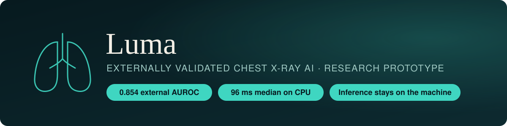
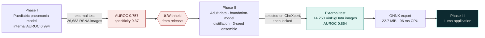
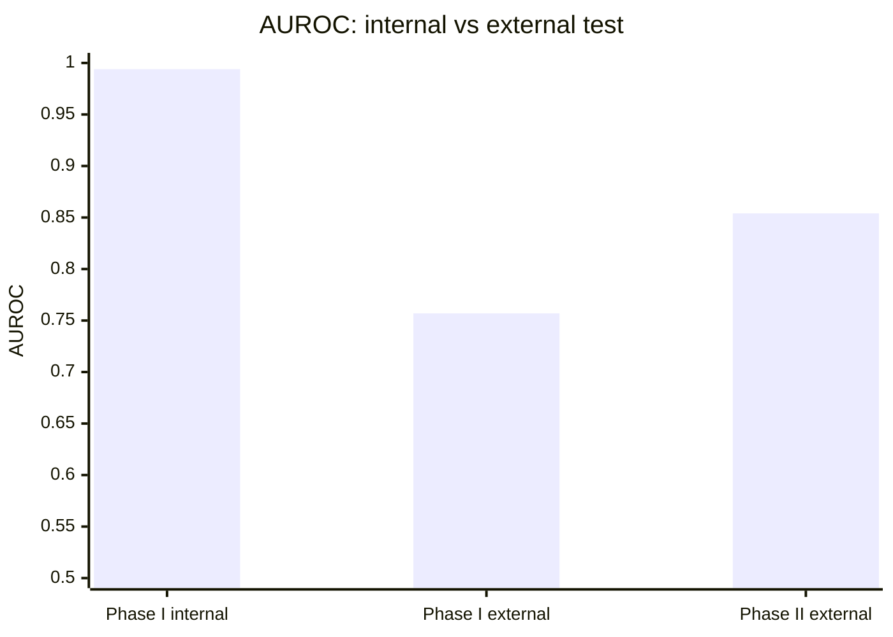
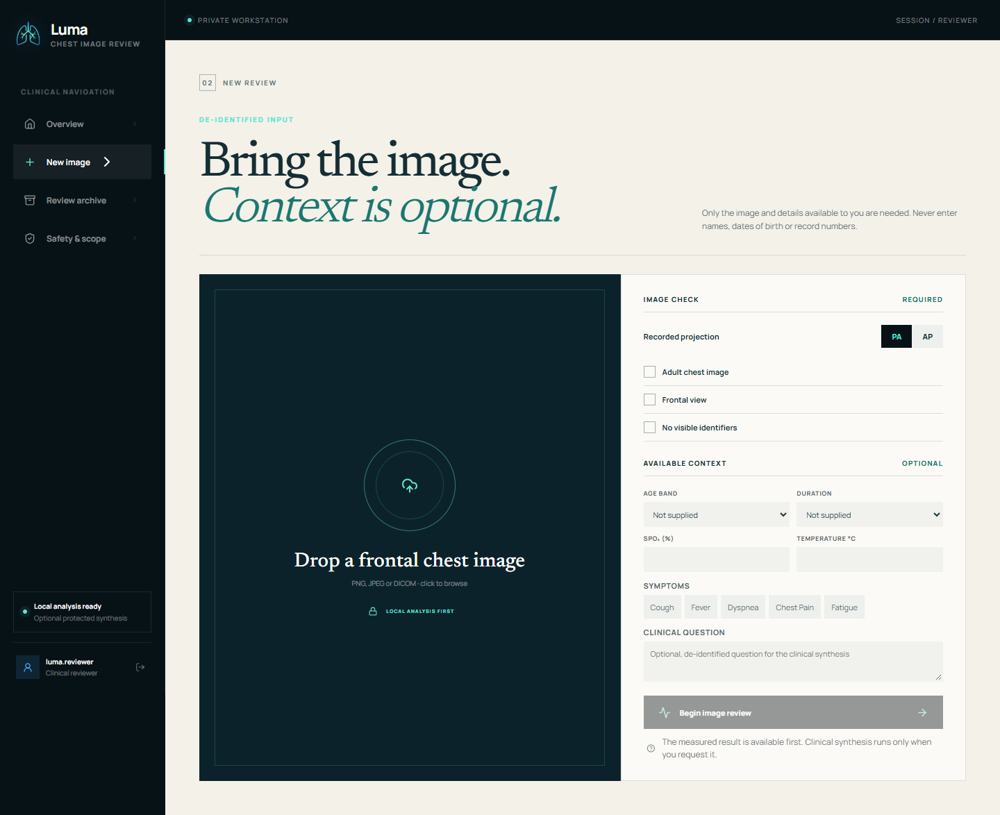
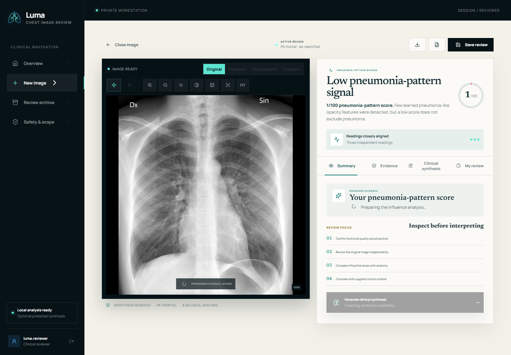
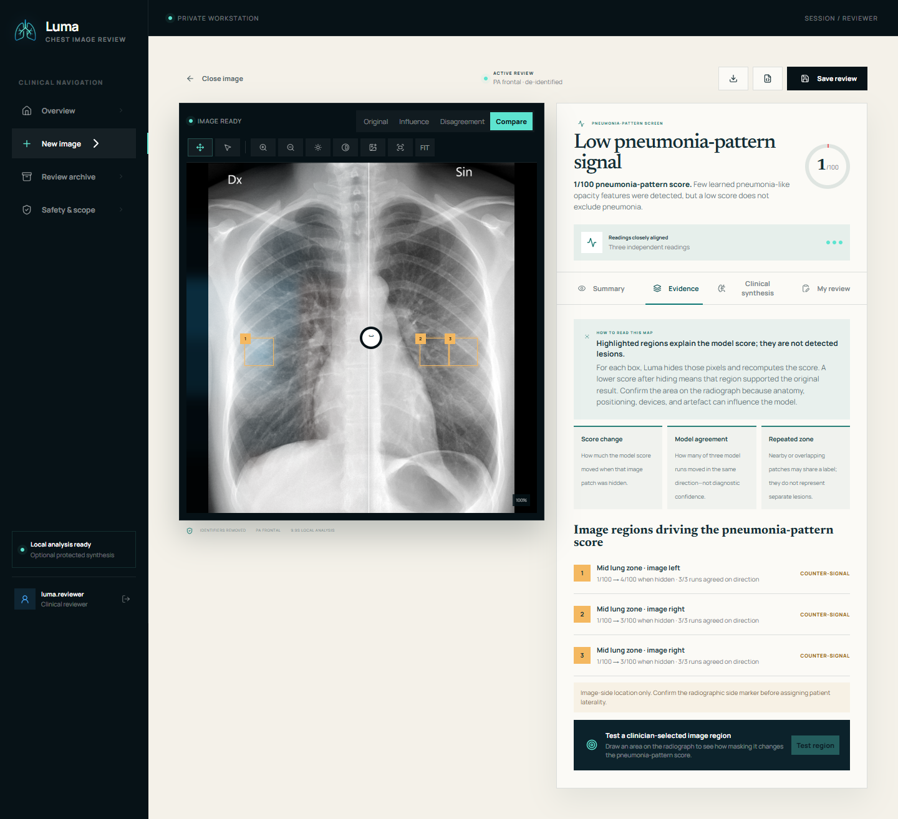
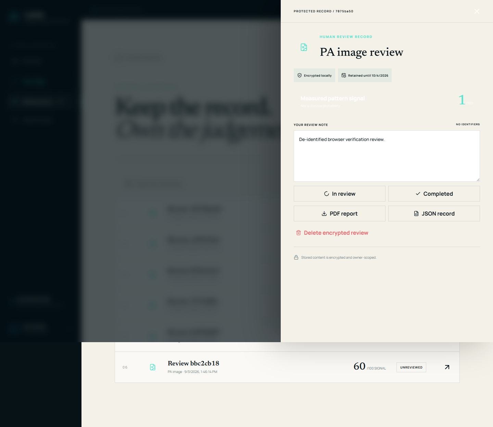
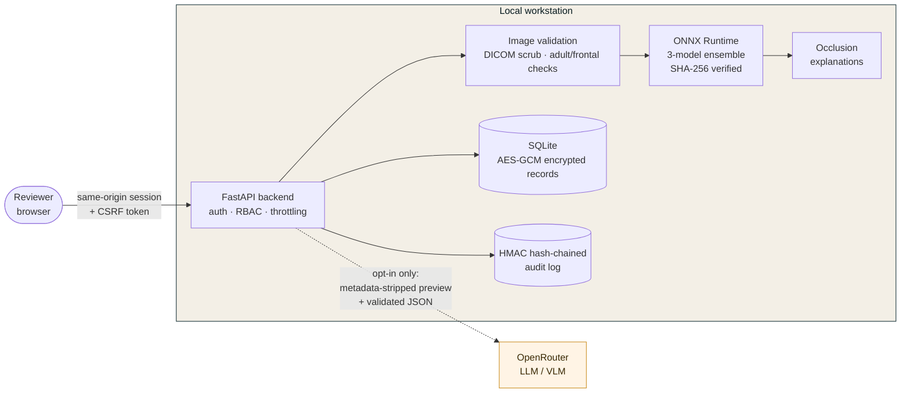

 

**[▶ Watch the demo](https://youtu.be/d6H16-UNWZ4)** · [Model card](docs/MODEL_CARD.md) · [Architecture](docs/ARCHITECTURE.md) · [Evaluation](docs/EVALUATION.md)

---

> [!NOTE]
> **About this repository.** This is the public showcase for Luma, built during my engineering internship at
> ESPRIT-Tech (Jul–Sep 2026). The source code, notebooks and model weights are private while the related
> research paper is under peer review. Code walkthroughs are available to recruiters and interviewers on request.

> [!WARNING]
> Luma is an academic research demonstration. It is **not a medical device** and must not be used for diagnosis,
> triage, treatment or patient communication.

## 🎬 Demo

 Click to watch the walkthrough on YouTube

## 💡 The story in one minute

My first model looked excellent: **0.994 AUROC** on its internal test set. Then I tested it on an external hospital
dataset and it fell to **0.757**, with specificity of **0.37** at its pre-set threshold. I withheld it from release
and rebuilt the pipeline around external validation. The model that now ships in Luma was **locked before it ever saw
its external test set**.

## 📊 Results at a glance

| | Phase I (withheld) | Phase II (shipped in Luma) |
|---|---|---|
| **Task** | Paediatric pneumonia vs normal | Adult air-space opacity (pneumonia proxy) |
| **Development data** | 5,824 unique paediatric images (Kermany) | 16,512 adult training images (RSNA) |
| **External test** | 26,683 RSNA images | 14,250 VinBigData PA images, untouched until the model was locked |
| **Internal AUROC** | 0.994 | — |
| **External AUROC** | 0.757 | **0.854** (95% CI 0.839–0.869) |
| **Decision** | ❌ Withheld | ✅ Released into Luma |

<b>More Phase II external metrics (click to expand)</b>

 

| Measure (VinBigData, n = 14,250) | Estimate | 95% CI |
|---|---|---|
| AUROC | 0.854 | 0.839–0.869 |
| Brier score | 0.049 | — |
| Brier skill score | 0.112 | 0.082–0.142 |
| Expected calibration error (equal-width) | 0.061 | — |
| AUROC difference vs DenseNet-121 reference¹ | +0.031 | 0.019–0.044 |

Confidence intervals come from 2,000 bootstrap samples. 
¹ The reference is a single-seed model, so this contrast mixes architecture and ensemble-size effects. It is reported
for completeness, not as evidence that distillation helps.

Full definitions and caveats: [docs/EVALUATION.md](docs/EVALUATION.md).

## 🖥️ The application

<table>
<tr>
<td width="50%"> <b>Intake.</b> Image checks are required; clinical context is optional and de-identified.</td>
<td width="50%"> <b>Result.</b> A plain-language score from three independent model readings.</td>
</tr>
<tr>
<td width="50%"> <b>Evidence.</b> Occlusion maps show which regions moved the score, and whether all three models agreed.</td>
<td width="50%"> <b>Saved review.</b> Records are encrypted locally, owner-scoped and exportable as PDF or JSON.</td>
</tr>
</table>

<b>✨ Features (click to expand)</b>

 

- **Local inference.** A three-model ONNX ensemble runs on CPU. Luma never falls back to a fake or LLM prediction: if the
  model files fail verification, analysis is reported as `WITHHELD`.
- **Input validation.** DICOM, PNG and JPEG are accepted, with adult/frontal checks. Original uploads are never stored.
- **Explanations.** Occlusion sensitivity tests a 6×6 grid, then refines the three most influential regions (48 masked
  inputs in total), reporting how many of the three models agreed on each region.
- **Clinician-drawn regions.** The reviewer can mask any area and see how the score changes.
- **Optional report synthesis.** On request, a two-pass LLM/VLM synthesis produces structured observations,
  differential considerations and uncertainty. It is clearly labelled as unvalidated.
- **Review workflow.** Review states, notes, encrypted search, retention dates, and PDF/JSON export.
- **Role-based access.** Separate reviewer, administrator and auditor roles, including an auditor-only event timeline.

## 🏗️ Architecture

Details, including the synthesis data flow: [docs/ARCHITECTURE.md](docs/ARCHITECTURE.md).

<b>🔐 Security and privacy controls (click to expand)</b>

 

| Area | Control |
|---|---|
| Authentication | Argon2id password hashes, login throttling, strict same-origin session cookies |
| Authorisation | Route-level RBAC with reviewer, administrator and auditor roles |
| Web | CSRF protection, Host-header allow-list |
| Data at rest | AES-GCM encryption of scrubbed images, notes and search vectors; key material protected by the OS |
| Integrity | HMAC hash-chained audit events; SHA-256 verification of every model artefact before ONNX sessions open |
| Data minimisation | Original uploads are never persisted; DICOM headers are stripped |
| LLM boundary | The optional synthesis is the only outbound call. The vision pass receives only a re-encoded, metadata-free grayscale preview, and the text pass receives no image. Outputs are checked against a strict JSON schema, retried once, then fail closed. Secrets never reach the frontend, logs or exports. |

<b>🧪 Engineering and verification (click to expand)</b>

 

| Check | Result |
|---|---|
| Phase II inference and export tests | 47 passing |
| ONNX vs PyTorch probability agreement | max difference 4.8 × 10⁻⁷ |
| Luma backend tests (7 Sep 2026) | 43 passing, 1 live-provider test skipped by design |
| Frontend | TypeScript type check and production build passing |
| CI | GitHub Actions on pull requests and pushes to main: ruff lint → pytest → typecheck → Next.js build |
| CPU benchmark (4 logical CPUs, ONNX Runtime 1.29) | 96 ms median · 118 ms p95 · +41.6 MiB memory · 22.7 MiB model files |

**Not yet done:** live evaluation of synthesis quality, clinical usability study, formal WCAG accessibility audit,
adversarial robustness benchmark.

## ⚠️ Limitations

<b>What these results do <i>not</i> show (click to expand)</b>

 

- **The target is a proxy.** "Positive" means at least two of three radiologists marked consolidation, infiltration or
  lung opacity. That is not confirmed pneumonia.
- **The scope is narrow.** Results cover adult **PA** images only. The 750 images where only one reader marked a finding
  were excluded, and AP performance was not established.
- **Teacher overlap is unmeasured.** The RAD-DINO teacher was pretrained on public datasets that include the NIH source
  of the RSNA images, and exact overlap was not measured.
- **The benefit of distillation is undetermined.** A full external comparison with and without distillation was not run.
- **These are retrospective results.** Discrimination and calibration on a public dataset do not establish clinical
  usefulness at any decision threshold.

## 🧰 Tech stack

**ML:** PyTorch · timm · MobileViT-XS · RAD-DINO (frozen teacher) · temperature scaling · bootstrap CIs 
**Serving:** ONNX Runtime · FastAPI · SQLite 
**Frontend:** Next.js · React · TypeScript · Motion 
**Security:** Argon2id · AES-GCM · HMAC audit chain · CSRF · RBAC 
**Tooling:** GitHub Actions · ruff · pytest · Docker

## 📄 Research

The Phase I study on pooling operators and external evaluation is **under peer review**. A citation and link will be
added after publication.

## 👩‍💻 Author

**Amani Hassani**, final-year Data Science engineering student at ESPRIT, Tunisia 
[LinkedIn](https://www.linkedin.com/in/amani-hassani/) · [GitHub](https://github.com/Amani-hassani)

Internship: ESPRIT-Tech (ESPRIT's research, development and innovation office), Jul–Sep 2026.

© 2026 Amani Hassani. All rights reserved. This repository contains documentation only. No licence is granted
to reuse the images or text without permission.
