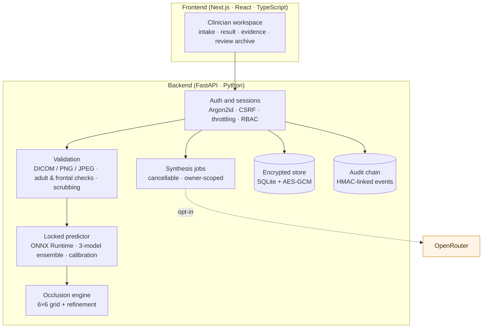
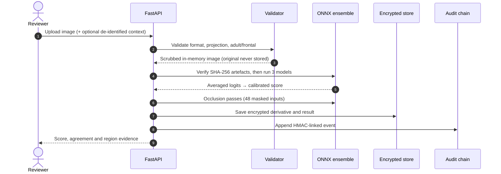

# Architecture

[← Back to README](../README.md)

Luma is a single-machine application. One FastAPI process serves the statically exported Next.js interface and every
`/api/v1` route from the same origin. Model inference, explanations, storage and audit logging all run locally.

## Components

## Request flow for one analysis

## Optional report synthesis (opt-in)

The synthesis runs only when the reviewer asks for it. The local result stays fully usable if it is unavailable.

| Pass | Receives | Never receives |
|---|---|---|
| 1. Vision review | Recorded projection and a re-encoded, metadata-free grayscale PNG preview | Original file, DICOM headers, model score, explanations, clinical context |
| 2. Clinical synthesis | Validated pass-1 JSON, bounded local evidence, coarse de-identified context | Any image bytes or original metadata |

Both passes must return strict JSON that matches a fixed schema. A malformed response gets one repair attempt, and the
job then fails closed. Deterministic safety checks run after generation and override the model, blocking autonomous
diagnosis, treatment orders and invented history. The API key is read only by the backend and never reaches the
browser, logs or exports.

## Delivery

- **CI:** GitHub Actions runs ruff lint, pytest, the TypeScript type check and the Next.js production build on pull
  requests and pushes to main.
- **Containers:** Dockerfiles exist for the web application. A cloud deployment was designed as infrastructure-as-code
  but retired in favour of the local-first design, for privacy reasons.
